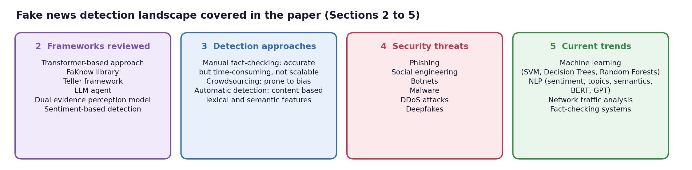
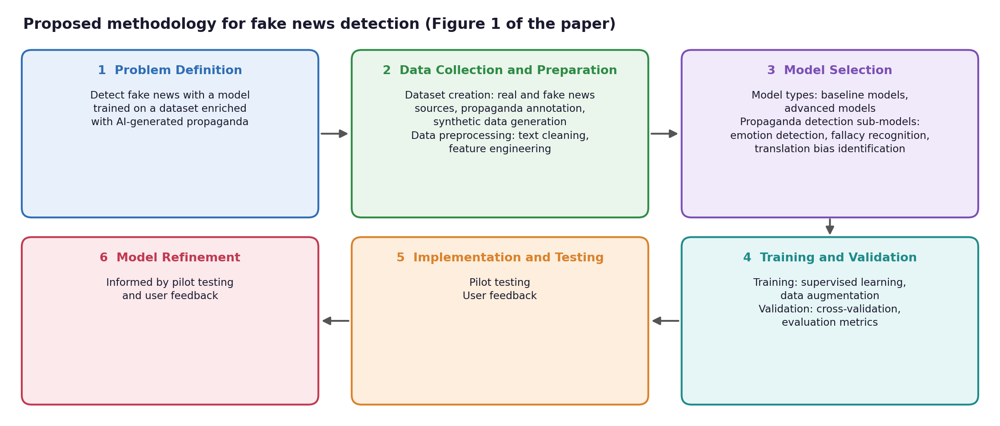
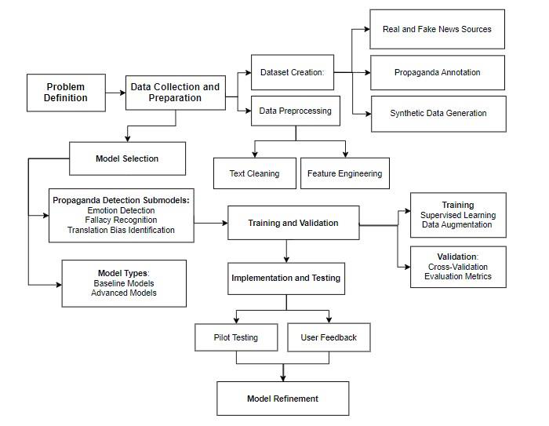

<div align="center">

# Fake News Detection: Current Trends and Innovative Methodologies

**A review of manual, machine-learning, NLP and LLM-based fake news detection, and a proposed methodology for propaganda-aware detection**


[Read the paper (PDF)](paper/Fake_News_Detection_Current_Trends_and_Innovative_Methodologies.pdf)

Farhan Ali Arshad
Advanced Topics in Computational Text and Media Science (NLP Seminar) · Universität Trier · Summer Semester 2024

</div>

---

## Overview

The widespread dissemination of false news presents substantial difficulties to both social trust and
cybersecurity (Abstract). This paper analyses current trends and methods in fake news identification, with an
emphasis on automated systems that use machine learning and NLP. It investigates transformer-based models,
domain-specific frameworks such as FaKnow, and LLM agents that combine external knowledge sources to improve
detection accuracy. It also examines the limitations of manual fact-checking and the role of cyber threats such
as phishing, botnets and deepfakes (Sections 2 to 5).

Building on the review, the paper presents a methodology for a fake news detection model that **recognises
propaganda strategies**, trained on a dataset enriched with AI-generated propaganda and supported by sub-models
for emotion detection, fallacy recognition and translation bias identification (Section 6).

> **Finding (Abstract, Conclusion):** combining machine learning, NLP and network analysis is a promising
> approach to fighting the spread of misinformation.

## What the paper covers



| Paper section | Content |
|---|---|
| **2. Literature review** | Transformer-based detection with content and social context, the Teller framework, the FaKnow library, an LLM agent for fake news detection, a comparison of classical ML models, a dual evidence perception model and sentiment-based detection |
| **3. Approaches** | Manual fact-checking (fact-checking websites, crowdsourcing) versus automatic content-based detection using lexical and semantic features |
| **4. Security threats** | Phishing, social engineering, botnets, malware, DDoS attacks and deepfakes as ways misleading information is spread |
| **5. Current trends** | Machine learning (SVM, Decision Trees, Random Forests), NLP (sentiment analysis, topic modelling, semantic analysis, BERT, GPT), network traffic analysis and automated fact-checking systems |
| **6. Proposed method** | A six-stage pipeline from problem definition to model refinement (Figure 1) |

## Related work at a glance

Reproduced from Table I of the paper; reference numbers follow the paper's bibliography.

| Work | Approach | Key features | Dataset | Findings |
|---|---|---|---|---|
| Transformer-based approach [14] | Transformer-based automated detection | Integrates social context and content analysis | Various online news datasets | Draws attention to the shortcomings of manual fact-checking and encourages the scalability of automated techniques |
| FaKnow [15] | Unified library structure | Several models, datasets and a PyTorch backend | Various fake news datasets | Increases the efficiency and repeatability of fake news research |
| Teller framework [9] | Explainable and generalisable detection | Logic templates and LLM integration | Various news datasets | Delivers clear and understandable detection results |
| Comparative analysis (AIP) [13] | Machine learning models | Logistic regression, random forests, decision trees | Various benchmark datasets | Decision Tree classifier is the most accurate; highlights the importance of high-quality datasets |
| Dual evidence perception model [14] | Graph neural networks and semantic analysis | Combines evidence from structure and semantics | News datasets, social media data | Addresses approaches that ignore semantic content |
| Sentiment analysis-based detection [14] | Integration of sentiment analysis | Content-based identification and analysis of emotional tone | ISOT, LIAR | Sentiment analysis increases detection accuracy |
| Content and social context-based detection [14] | Content and social context features | Social interaction and style features | Various news datasets | Highlights issues with flexibility and the need for reliable models |
| Fact-checking and algorithm strategies [8] | Integration of fact-checking | Algorithmic strategies combined with fact-checking tasks | Various fact-checking datasets | Shows how advanced algorithms are integrated with fact-checking |
| LLM agent [8] | Large language model agent | Structured expert workflow and domain knowledge | Snopes, PolitiFact, GossipCop | Increases detection accuracy through external search engines and subject expertise |

## Proposed methodology



The pipeline follows Figure 1 and Section 6 of the paper.

| Stage | Details from the paper |
|---|---|
| **1. Problem Definition** | Develop a model that detects fake news by training it on a dataset enriched with AI-generated propaganda |
| **2. Data Collection and Preparation** | *Dataset creation:* a balanced mix of verified real and confirmed fake news from real and fake news sources, propaganda annotation, and synthetic data that mimics the style and substance of real propaganda. *Data preprocessing:* text cleaning to reduce noise, and feature engineering (feature groups below) |
| **3. Model Selection** | *Model types:* baseline models (Logistic Regression, SVM, Decision Trees) and advanced models (LSTM, BERT, Transformer-based models fine-tuned on the propaganda-loaded dataset). *Propaganda detection sub-models:* emotion detection for emotionally laden words, fallacy recognition for typical logical fallacies, and translation bias identification |
| **4. Training and Validation** | *Training:* supervised learning on the labelled dataset with propaganda labels as input features; data augmentation through paraphrasing or back-translation. *Validation:* k-fold cross-validation for reliability and against overfitting; evaluation with accuracy, precision, recall, F1-score and AUC-ROC, with special emphasis on detecting propaganda |
| **5. Implementation and Testing** | Pilot testing and user feedback |
| **6. Model Refinement** | Final stage, informed by pilot testing and user feedback |

**Feature types (Table II of the paper)**

| Textual features | Metadata features | Social context features | Graph-based features |
|---|---|---|---|
| TF-IDF | Source reliability | User engagement metrics | Propagation graphs |
| N-grams | Publishing date and time | Network structure | Centrality measures |
| Sentiment analysis | Author reputation | User profile information | |

<details>
<summary><b>Original methodology figure from the paper</b></summary>
<br>
<p align="center"></p>
</details>

## Key takeaways

1. **Manual fact-checking is accurate but does not scale** (Section 3.1). It is time-consuming and not scalable to
   the volume of online content; crowdsourcing is prone to biases and differing levels of competence.
2. **Transformer models and LLM agents advance detection** (Sections 2 and 5.2). BERT and GPT have shown
   substantial success in interpreting language and identifying subtle signs of false news; an LLM agent improves
   accuracy by using external search engines and domain knowledge.
3. **Explainability builds trust** (Section 2). The Teller framework decomposes fact-checking with logic templates
   and LLMs to produce transparent, interpretable results.
4. **Misinformation is also a cybersecurity problem** (Sections 4 and 5.3). Phishing, social engineering, botnets,
   malware, DDoS attacks and deepfakes help spread false information, and network analysis of propagation
   patterns can reveal coordinated misinformation efforts.
5. **Propaganda-aware detection is the proposed next step** (Abstract, Section 6). A model that recognises
   propaganda strategies lays the groundwork for future developments in this field.

## Related project

[German Harmful Content Detection](https://github.com/farhanaliarshad1/german-harmful-content-detection) is a
later, hands-on project that compares transformers, a multi-task model and LLM prompting for German fake news,
hate speech and toxicity.

## Citation

```bibtex
@misc{arshad2024fakenews,
  title  = {Fake News Detection: Current Trends and Innovative Methodologies},
  author = {Arshad, Farhan Ali},
  year   = {2024},
  note   = {Seminar paper, Advanced Topics in Computational Text and Media Science, Universit{\"a}t Trier}
}
```

## License

The paper and figures are shared for portfolio and educational purposes. Please cite the paper if you use its
content.
